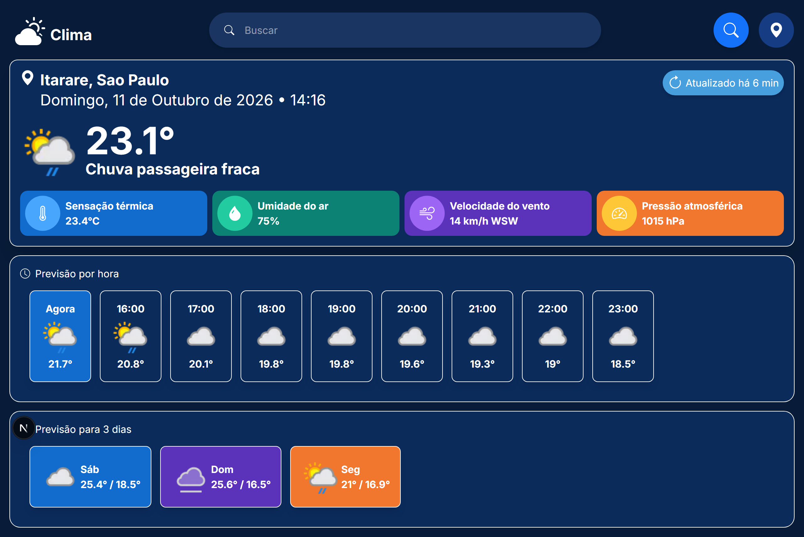
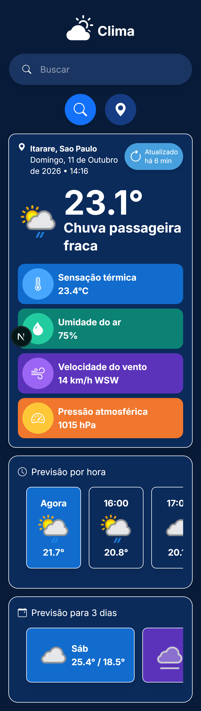

# Consulta clima

## Aplicativo para consultar o clima desenvolvido com Next JS

## Preview no desktop


## Preview no mobile


- Tecnologias utilizadas
  - React JS
  - Next JS
  - Typescript
  - Tailwind CSS

### Como baixar e executar o projeto localmente:

#### Baixe e instale o Node.js e o yarn

#### Clone o repositório na área de trabalho do seu computador

```bash
  git clone https://github.com/alexsander-gutierrez-goncalves/weather-forecast-next-app.git
```

#### Acesse a pasta do projeto

```bash
  cd weather-forecast-next-app
```

#### Instale as dependências 

```bash
  yarn
```

#### Configure a API de clima
  - Acesse o site https://www.weatherapi.com/ para obter uma chave de API gratuitamente.
  - Crie o arquivo .env.local na raiz do projeto e adicione o seguinte conteúdo.
  
  ```.env
    API_KEY=suachavedeapi
  ```

#### Execute o projeto localmente

```bash
  yarn dev
```

#### Execute localmente acessando o link abaixo

```bash
  http://localhost:3000
```

<a href="https://weather-forecast-next-app.vercel.app/" title="Consultar o clima" target="_blank">Executar demo</a>
